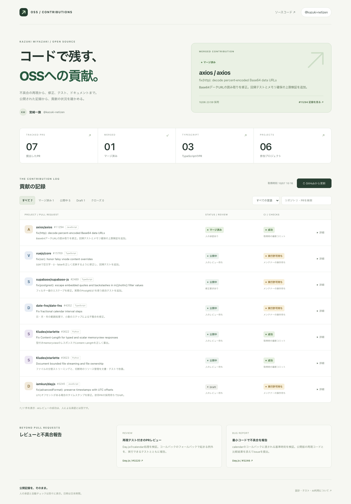

# OSS Contribution Dashboard

[](https://github.com/kazuki-netizen/oss-contribution-dashboard/actions/workflows/ci.yml)
[](https://github.com/kazuki-netizen/oss-contribution-dashboard/actions/workflows/pages.yml)

宮﨑一旗（[@kazuki-netizen](https://github.com/kazuki-netizen)）のOSS貢献を確認できる、TypeScript製のダッシュボードです。公開PRの状態、ユーザーのレビュー、CIを取得し、検索・言語・状態で絞り込めます。

**[公開ダッシュボードを見る](https://kazuki-netizen.github.io/oss-contribution-dashboard/)**



## このツールを作った理由

OSSへPRを提出すると、その後もレビューやCIを確認する必要があります。しかし、自動レビューが成功していても、人による承認が付いたとは限りません。また、GitHub Actionsにはメンテナーの実行許可を待つ状態があります。

このツールでは、それぞれの状態を別々に表示します。取得に失敗した場合も、前回の記録を残し、どの情報が未取得なのかを示します。そのため、API障害や利用上限があっても、保存済みの記録と取得時刻を確認できます。

## TypeScriptで実装した範囲

- `strict`、`noUncheckedIndexedAccess`、`exactOptionalPropertyTypes`を有効にした型設計。
- `unknown`から外部APIの応答を検証し、ドメインの型へ変換する処理。
- `Remote<T>`で、取得成功・取得失敗・保存済みデータを表すジェネリクス。
- PRを公開中・Draft・クローズ・マージ済みに分ける判別可能なユニオン型。マージ済みには採用日時を必須にしています。
- レビュー履歴、CI、再実行、取得失敗を扱う集計処理と、型チェックで検証する契約。
- DOM APIでの画面表示、検索、フィルター、キャッシュ、スマートフォン表示。

アプリの実装に`any`は使っていません。APIのJSONに型を付ける前に、値・日時・URL・コミット・著者を実行時に確認します。検証に使うオブジェクトへの型アサーションは、オブジェクトであることを確認した箇所に限定しています。

## 起動する

Node.js 24以降を使います。

```sh
npm ci
npm run dev
```

リポジトリには、GitHubから取得した公開記録が`public/snapshot.json`として入っています。起動時はこの記録を読み込むため、GitHubの認証情報を入力せずに使えます。画面の「GitHubから更新」で、公開APIから最新情報を取得します。

ブラウザで取得した記録は、そのブラウザのlocalStorageに保存します。取得に失敗した項目には未取得の表示を付けます。GitHubの匿名APIには利用上限があるため、連続更新は1分間隔に制限し、上限に達した場合はその取得処理の後続リクエストを止めます。この1分の制限が、APIの利用枠を保証するものではありません。

## 設計と検証

```text
GitHub REST API → unknownの検証 → 型付きの取得結果 → 状態の集計 → DOMで表示
                                     ↓
                           JSONスナップショット / キャッシュ
```

| ファイル・ディレクトリ       | 役割                                       |
| ---------------------------- | ------------------------------------------ |
| `src/config.ts`              | 追跡するPRと言語、貢献内容                 |
| `src/domain/`                | 取得結果の型と、レビュー・CIの集計         |
| `src/github/parse.ts`        | API応答と保存済みデータの実行時検証        |
| `src/github/client.ts`       | ページ送り、利用上限、最新コミットの取得   |
| `src/ui/`                    | DOM表示とキャッシュ                        |
| `scripts/update-snapshot.ts` | 公開スナップショットの生成                 |
| `tests/`                     | 集計・取得・検証のテストと型の契約         |
| `e2e/`                       | Chromiumのデスクトップ・モバイル表示テスト |

主な検証対象は次の通りです。

- AIサービスのレビューを、人による承認として数えない。
- コメントが追加されても、過去の承認を自動で取り消さない。却下された承認や別のレビュアーの修正要求も扱う。
- レビューの2ページ目に承認がある場合まで取得する。
- Actionsの`action_required`を、CI成功とは別に表示する。
- 同じワークフローの再実行と、同名の別ワークフローを区別する。
- PRのコミットが変わった場合、前のコミットのCIを新しい結果として再利用しない。
- 通信失敗、403、APIの利用上限、不正なJSON、壊れたキャッシュ、localStorageの利用禁止を扱う。
- 検索、言語・状態フィルター、空の結果、モバイルの画面幅を検証する。
- APIのタイトルをテキストとして表示し、HTMLとして実行しない。

```sh
npm run check
npx playwright install chromium
npm run test:e2e
```

`npm run check`は整形、型チェック、ユニットテスト、ビルドを実行します。`tests/type-contracts.ts`は、不正な型の組み合わせがコンパイル時に拒否されることを検証します。CIと公開用のワークフローでも、型チェック・ユニットテスト・ブラウザテストを実行します。

### 公開データを更新する

認証済みのGitHub CLIがある場合は、次のコマンドを使えます。

```sh
npm run snapshot:update -- --github-cli
```

CIでは、`GITHUB_TOKEN`をNode.js側の取得スクリプトにだけ渡します。トークンを公開JSON、ブラウザのバンドル、localStorageに保存する処理はありません。更新に失敗するとスクリプトは終了コード1を返し、公開用ワークフローは新しいサイトの配置を止めます。

GitHub Pagesへの配置は`main`へのpush、または[Deploy dashboard](https://github.com/kazuki-netizen/oss-contribution-dashboard/actions/workflows/pages.yml)の手動実行で行います。定期取得やIssue・レビュー・PRの投稿は行いません。

### 集計の範囲

CIはPRの最新headコミットに対するCheckRuns、Commit statuses、GitHub Actionsから集計します。「成功」は取得できた記録の成功を示し、マージの可否やすべての必須チェックを保証する表示ではありません。未取得の情報がある場合は「取得不完全」にします。

レビューではGitHubのBot属性に加え、`coderabbitai`、`cubic-dev-ai`、`greptile-apps`、`codspeed`、`github-actions`を除外しています。Userアカウントで動く未知の自動サービスまで、完全に識別するものではありません。また、人の承認があっても、その人にマージ権限があるとは限りません。元のPRへのリンクから正式な状態を確認できます。

追跡対象は`src/config.ts`で指定した公開PRです。アカウントのすべての貢献やコミットを網羅するツールではありません。PR以外のレビュー・不具合報告カードには、投稿記録へのリンクを掲載しています。

## OSSへの貢献記録

以下は2026年10月7日に確認した記録です。現在の状態は公開ダッシュボード、または各PRをご確認ください。

| プロジェクト                                                        | 実装言語   | 内容                                                | 確認時の状態 |
| ------------------------------------------------------------------- | ---------- | --------------------------------------------------- | ------------ |
| [Axios #11294](https://github.com/axios/axios/pull/11294)           | JavaScript | Base64データURLの読み取り、割り当て上限、回帰テスト | マージ済み   |
| [Vue #15769](https://github.com/vuejs/core/pull/15769)              | TypeScript | SSRで空文字・0・falseを反映する処理とテスト         | 公開中       |
| [Supabase #2489](https://github.com/supabase/supabase-js/pull/2489) | TypeScript | フィルター値のエスケープとPostgREST統合テスト       | 公開中       |
| [date-fns #4352](https://github.com/date-fns/date-fns/pull/4352)    | TypeScript | 小数ステップでの日付範囲処理とテスト                | 公開中       |
| [Starlette #3622](https://github.com/Kludex/starlette/pull/3622)    | Python     | memoryviewのContent-Length算出                      | 公開中       |
| [Starlette #3623](https://github.com/Kludex/starlette/pull/3623)    | Python     | ファイルストリーミングの文書と回帰テスト            | 公開中       |
| [Day.js #3245](https://github.com/iamkun/dayjs/pull/3245)           | JavaScript | UTCオフセットを含むタイムスタンプの修正             | Draft        |

このほか、Day.jsへ[再現テスト付きのレビュー](https://github.com/iamkun/dayjs/pull/3220#pullrequestreview-5410437825)と[最小コード付きの不具合報告](https://github.com/iamkun/dayjs/issues/3246)を投稿しています。

AxiosはJavaScriptで実装された修正です。TypeScriptの実績としては、このダッシュボードのコード・テストと、TypeScriptで実装したVue・Supabase・date-fnsの提出PRを確認できます。提出済みのPRと、採用済みのPRは分けて記載しています。

## AIの利用とライセンス

このリポジトリの実装・テスト・文書作成にはOpenAI Codexを利用しています。公開したコード、実行したテスト、GitHub Actionsの記録から内容を確認できます。人によるコードレビューを実施したという主張はしていません。

MIT License。著者: Kazuki Miyazaki / kazuki-netizen。

参考: [TypeScript strict](https://www.typescriptlang.org/tsconfig/strict.html)、[Generics](https://www.typescriptlang.org/docs/handbook/2/generics.html)、[Narrowing](https://www.typescriptlang.org/docs/handbook/2/narrowing.html)、[GitHub APIの利用上限](https://docs.github.com/en/rest/using-the-rest-api/rate-limits-for-the-rest-api)、[Actions実行記録](https://docs.github.com/en/rest/actions/workflow-runs#list-workflow-runs-for-a-repository)。
